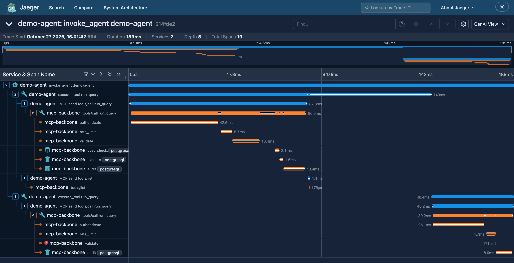
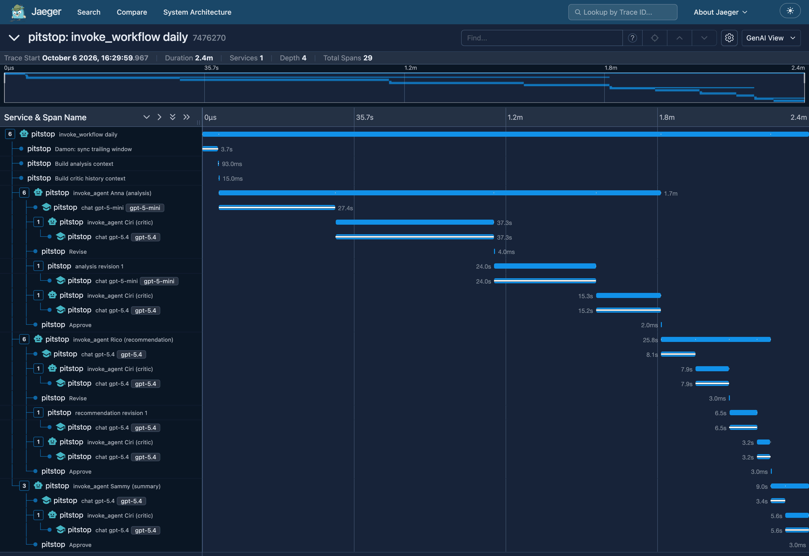
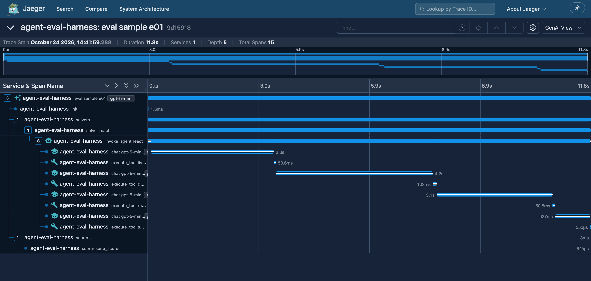

# agent-observability

One tracing pipeline across a set of agent projects. Each project emits
OpenTelemetry traces that follow the GenAI semantic conventions, into one
small, self-hosted trace viewer (Jaeger v2), so a single agent request can
be followed from the agent through an MCP server to the database, with the
latency and the cost of every step.

**Status:** three sources are in, at $0. The live end-to-end trace through
the MCP security gateway is the next slice
([Phase 7](docs/planning/phase-7-slices-plan.md)).

| Source | How | State |
|---|---|---|
| [MCP-backbone](https://github.com/NabilRobert/MCP-backbone) (MCP server) | Live: a span per stage of every tool call, under the MCP SDK's own span | Built, merged (opt-in by setting an endpoint) |
| [Pitstop](https://github.com/NabilRobert/pitstop-crew-public) (agent pipeline) | Replayed: its 62 recorded runs (653 steps) from a backup, with the original times | Built, checked |
| [agent-eval-harness](https://github.com/NabilRobert/agent-eval-harness) (agent evaluation) | Replayed: its 20 published Inspect runs (1,777 samples, 7,068 real model calls), with the original times and each call's own cost | Built, checked |
| [MCP security gateway](https://github.com/NabilRobert/mcp-security-gateway) | Live, built in its own project | The trace already passes through it unbroken; its own spans are next |
| agent-eval-harness, live | A scripted agent through the gateway to MCP-backbone ($0) | Next; a stand-in agent runs the path today |

## What it looks like

An agent process calling MCP-backbone: one trace across two processes.
The agent's trace context travels in each MCP request's `_meta`; the
refused `DELETE` is marked on the stage that refused it (`validate`), and
no SQL text is recorded.



A Pitstop daily run, replayed from its records: the workflow, its agents,
the critic's reviews and revisions, and every model call with its tokens
and cost.



One of the harness's evaluation samples, replayed from its Inspect log:
an agent answering a question about the Pagila database through
MCP-backbone's tools. Of its 11.8 s, the four model calls take 11.5 s; the
tool calls take 50–100 ms each.



## What's checked

- **No content by default.** MCP-backbone records no SQL text, rejection
  reasons or error messages unless `APP_OTEL_CAPTURE_CONTENT` is on; a
  test plants a marker in every path a query's text can take (run,
  refused, errored, a failed audit write) and finds it in no span. The
  replay never reads Pitstop's prompts and responses.
- **Tracing can't hurt the traced system.** With the viewer down, tool
  calls still succeed, and a shutdown gives up flushing after 2 s,
  however many spans are queued (the SDK alone took 5.3 s with a full
  queue). Without an endpoint configured, nothing is exported at all.
- **The replays are faithful.** Every recorded step appears once, with
  the same parent, start time (to the microsecond) and duration. For
  Pitstop, the model-call costs in each run add up to its recorded total
  (26 runs had one); for the harness, each sample's model-call cost and
  tokens add up to its recorded totals. `0 problems` on all 62 Pitstop
  runs and all 1,777 harness samples, checked against the viewer's API.
- **Cheap, measured at the median and the tail.** Tracing adds
  **+0.39 ms** to the median MCP-backbone tool call (95% CI +0.29 to
  +0.50), **1.4%** of a 27 ms call, with the viewer up; building the spans
  is about 80 µs of that (110 µs on, 31 µs off). At p95 and p99 there is
  no detectable difference (+1.7 ms, CI −1.2 to +4.6; −0.3 ms, CI −13 to
  +12). A first run showed p99 rising from 91 to 126 ms, but it ran while
  the machine's load drifted upwards; on a quiet machine it didn't
  reproduce. The one tail effect found: the 24 of 1,500 calls that ran
  while the exporter was sending were all slower than the untraced p95,
  against 4.3% of the other calls, so a send does slow the calls it
  overlaps, but too rarely to move p99. Details:
  [`docs/mcp-backbone-overhead.md`](docs/mcp-backbone-overhead.md).
- **Small.** Jaeger runs in 256 MB, keeping at most 5,000 traces in
  memory: 79 MiB with both replays loaded (29,500 spans). Its disk store
  was the first choice and peaked at 532 MiB on the same import, so it was
  dropped; a restart now empties the viewer, and the replays refill it in
  seconds.
- Every new test was mutation-checked: 12 mutations in MCP-backbone and
  20 in the replays, all caught. One exposed a real bug (the exporter
  ignored the endpoint it was given), now fixed.

## Run it

Needs Docker and [uv](https://docs.astral.sh/uv/).

```bash
docker compose -f viewer/compose.yaml up -d
```

```bash
uv run python viewer/smoke.py
```

The UI is at http://127.0.0.1:16686. On the shared server, follow
[`viewer/RUNBOOK.md`](viewer/RUNBOOK.md).

Replay Pitstop's traces (needs the private backup):

```bash
replay/pitstop/run.sh path/to/pitstop.dump
```

Run the whole path locally, then check the trace (needs an MCP-backbone
checkout and the mcp-gateway repo; the gateway is exported with `git
archive`, so its checkout isn't touched):

```bash
uv run --project ../MCP-backbone python demos/end_to_end.py --backbone ../MCP-backbone --gateway ../mcp-gateway
```

```bash
uv run python -m e2e.check --service demo-agent --service mcp-security-gateway --service mcp-backbone
```

The check passes when the latest trace has one root, no span whose parent
is missing, every service on the path, and a database stage reached
through them in order. Today it reports the gateway as the one missing
service: requests already cross it in one unbroken trace, because it
forwards `_meta`, but it doesn't make spans of its own yet.

Replay the harness's published runs (needs a clone of agent-eval-harness;
read with `git show`, so its checkout isn't touched):

```bash
replay/inspect/run.sh path/to/agent-eval-harness
```

Trace MCP-backbone: set `OTEL_EXPORTER_OTLP_ENDPOINT=http://127.0.0.1:4318`
in its environment. The cross-process demo above is
[`demos/mcp_backbone_trace.py`](demos/mcp_backbone_trace.py).

Tests:

```bash
uv run pytest
```

## Docs

- [`docs/conventions.md`](docs/conventions.md): the span names and
  attributes every source follows.
- [`docs/planning/`](docs/planning/): Phases 1–7, from the problem brief
  to the slice plan, with the spike results.

## License

[MIT](LICENSE).
