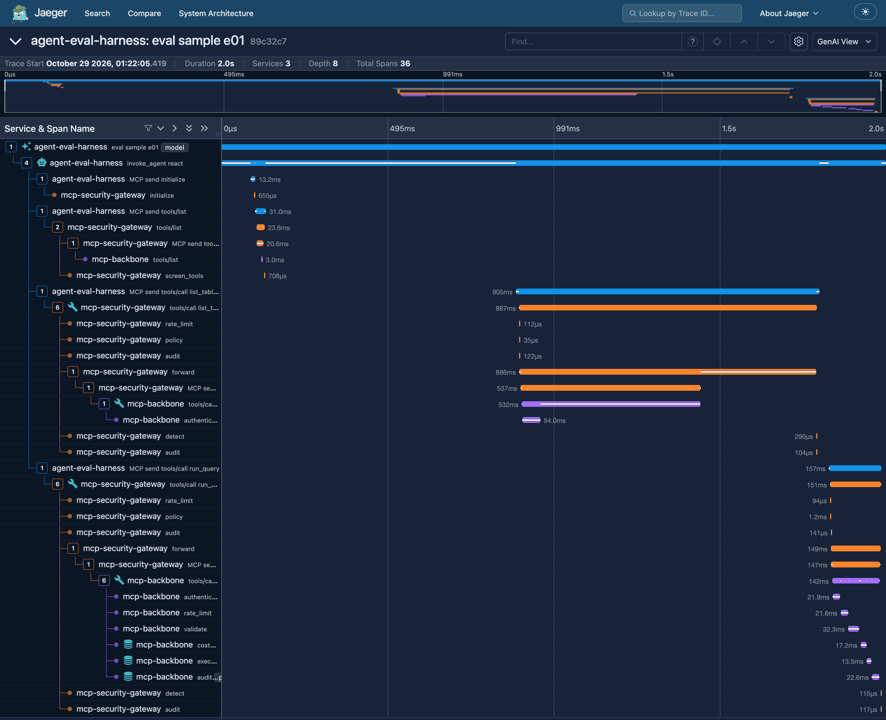

# agent-observability

One tracing pipeline across a set of agent projects. Each project emits
OpenTelemetry traces that follow the GenAI semantic conventions, into one
small, self-hosted trace viewer (Jaeger v2), so a single agent request can
be followed from the agent through an MCP server to the database, with the
latency and the cost of every step.

## What it shows

One evaluation sample, followed live as one trace: three services and 36
spans, from the evaluation harness through the MCP security gateway and
MCP-backbone to Postgres.



| Source | How | What's traced |
|---|---|---|
| [MCP-backbone](https://github.com/NabilRobert/MCP-backbone) (MCP server) | Live | Every stage of a tool call; +0.39 ms (1.4%) at the median |
| [MCP security gateway](https://github.com/NabilRobert/mcp-security-gateway) | Live | Every stage of a call, between the agent and the MCP server |
| [agent-eval-harness](https://github.com/NabilRobert/agent-eval-harness) (agent evaluation) | Live and replayed | Live: each sample, agent and MCP call. Replayed: 1,777 published samples, 7,068 model calls |
| [Pitstop](https://github.com/NabilRobert/pitstop-crew-public) (agent pipeline) | Replayed | 62 recorded runs, 653 steps |

The replays keep the original times and costs, and match their records
with 0 problems. The other screenshots, and how each number was checked,
are in [`docs/results.md`](docs/results.md).

## Run it

Needs Docker and [uv](https://docs.astral.sh/uv/). Start the viewer, open
its UI at http://127.0.0.1:16686, and send it a test span:

```bash
docker compose -f viewer/compose.yaml up -d
```

```bash
uv run python viewer/smoke.py
```

[`docs/running.md`](docs/running.md) has the rest: the end-to-end trace,
the harness replay, tracing MCP-backbone, and the tests.

## Layout

| Folder | What it does |
|---|---|
| `viewer/` | The trace viewer (Jaeger) and its smoke check |
| `replay/` | Rebuilds traces from records: Pitstop's and the harness's |
| `e2e/` | The end-to-end check: one trace across every service |
| `demos/` | Runs the live path locally, and the overhead benchmark |
| `tests/` | The mappings and checks, on synthetic records |
| `docs/` | The guide, the conventions, the results and the planning trail |

## Docs

- [`docs/guide.md`](docs/guide.md): start here. Each flow step by step, a
  glossary, and where to change things.
- [`docs/conventions.md`](docs/conventions.md): the span names and
  attributes every source follows.
- [`docs/results.md`](docs/results.md): what's checked, and the numbers.
- [`docs/mcp-backbone-overhead.md`](docs/mcp-backbone-overhead.md): what
  tracing costs an MCP-backbone tool call, measured.
- [`docs/planning/`](docs/planning/): the plan and the decisions.

## License

[MIT](LICENSE).
