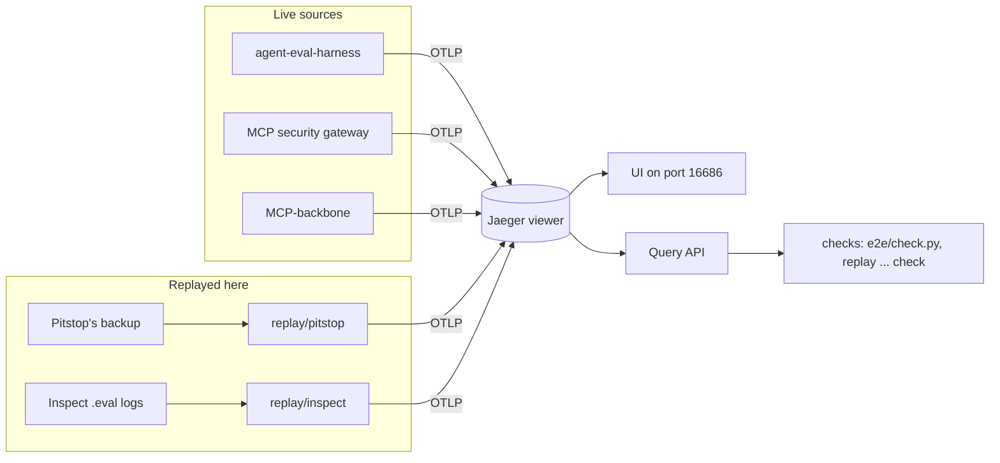
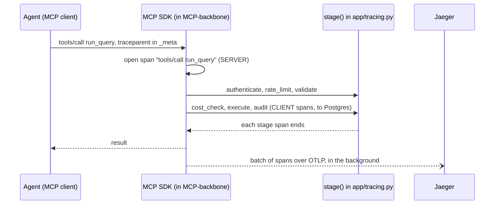
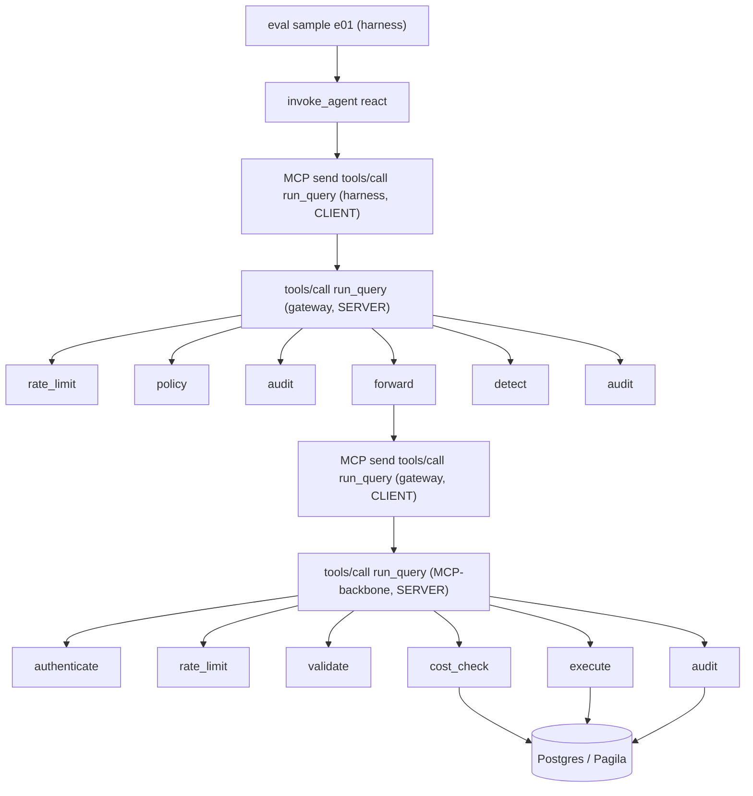
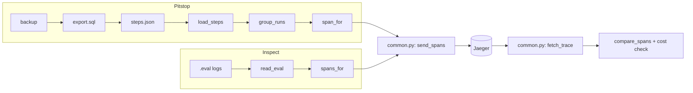

# A guide to agent-observability

This repo follows one agent request across several projects. Each project
sends a record of its work, called a **trace**, to one small trace viewer.
In the viewer you can see each step of the request, how long it took and
what it cost.

There are two kinds of source:

- **Live sources** send spans while they run: MCP-backbone (an MCP
  server), the MCP security gateway, and the agent-eval-harness.
- **Replayed sources** finished running long ago, so this repo rebuilds
  their traces from their records: Pitstop (an agent pipeline) and the
  harness's published Inspect logs.

This guide walks through each flow, file by file, then explains the words
it uses, then says where to change things. The rules every source follows
(span names and attributes) are in [`conventions.md`](conventions.md).

## Flow 1: a live MCP-backbone tool call becomes spans

This code lives in the MCP-backbone repo, not here. This repo set the
rules and checks the result.

1. **Startup.** `app/main.py: lifespan` calls
   `app/tracing.py: configure_tracing`. That asks `build_span_processor`
   whether `OTEL_EXPORTER_OTLP_ENDPOINT` is set. If it isn't, nothing is
   installed and every span is a no-op. If it is, a tracer provider with
   a background exporter is installed.
2. **A request arrives.** The MCP SDK itself opens the request's span,
   `tools/call run_query` (kind SERVER). If the caller sent a trace
   context in the request's `params._meta`, this span joins the caller's
   trace.
3. **Authenticate.** `app/mcp/server.py: run_query` calls `_authenticate`,
   which wraps its work in `stage("authenticate")`.
4. **The query's stages.** `app/query/service.py: run_query` runs each
   stage inside its own `stage(...)`:
   `_check_rate_limit` (`rate_limit`), `_validate` (`validate`),
   `_estimate_cost` (`cost_check`), `_execute` (`execute`), and, through
   `_finish`, `write_audit` (`audit`).
5. **A stage that fails.** `app/tracing.py: stage` catches the exception,
   and `mark_failed` sets `error.type` (a short, safe label). The
   human-readable reason goes on the span only if
   `APP_OTEL_CAPTURE_CONTENT` is on, because a reason can quote the SQL.
6. **Sending.** Finished spans wait in a queue. A background thread sends
   them in batches over OTLP to the viewer's port 4318. A dead viewer
   only loses spans; the tool call still succeeds.
7. **Shutdown.** `app/tracing.py: shutdown_tracing` gives the last spans
   at most 2 seconds to leave, so a dead viewer can't hold up a restart.
8. **The viewer.** Jaeger runs in one container
   ([`viewer/compose.yaml`](../viewer/compose.yaml)). It keeps up to 5,000
   traces in memory ([`viewer/config.yaml`](../viewer/config.yaml)).

To see it without the rest of the path: `demos/mcp_backbone_trace.py`
starts MCP-backbone in one process (`serve`) and a small traced agent in
another (`agent`). The agent opens its own span and calls the tools, and
the server's spans join its trace.

## Flow 2: one request across harness → gateway → MCP-backbone → Postgres

This is the project's main goal: one trace, three services, down to the
database. `demos/end_to_end.py` sets it all up locally.

1. **Set-up.** `main` reads the options. `run` exports the gateway's code
   with `export_gateway` (a `git archive`, so its checkout isn't touched),
   points MCP-backbone at its test database with
   `demos/backbone.py: use_test_database`, and writes the gateway's config
   (`GATEWAY_CONFIG`). With `--agent harness`, `pagila_target_url` reads
   the harness's local Pagila login, and `pagila_proxy` opens a loopback
   port to it.
2. **Start the services.** `serve_and_run` uses
   `demos/backbone.py: seeded` to create a workspace and an API key.
   `running` starts MCP-backbone (`backbone_cmd`), and `wait_healthy`
   waits for it. Only then does it start the gateway, because the gateway
   checks its upstream when it starts.
3. **Run the agent.** `harness_agent` runs the harness's
   `scripts/scripted_pagila_agent.py`, given a `HarnessAgent` (which
   checkout, which tasks). The demo agent (`agent`) is the stand-in when
   there's no harness.
4. **In the harness.** `agent_eval/tracing.py: tracing_if_configured`
   installs the exporter. `traced_agent` opens `eval sample e01` and,
   under it, `invoke_agent react`. Each MCP call gets the SDK's client
   span, `MCP send tools/call run_query`, which puts the trace context
   into the request's `_meta`.
5. **In the gateway.** The SDK's server span, `tools/call run_query`,
   picks the context up. `src/mcp_gateway/proxy.py: Route._call_tool` runs
   the stages `rate_limit`, `policy`, `audit`, `forward`, `detect` and
   `audit` again. The call to MCP-backbone happens inside `forward`, so
   MCP-backbone's spans land under it.
6. **In MCP-backbone.** Flow 1, down to the database.
7. **Check the trace.** `e2e/check.py: main` finds the newest trace with
   `latest_trace` (which uses `replay/common.py: query_traces`), fetches
   it with `fetch_trace`, and runs `check_trace`. That looks for one root,
   no span whose parent is missing, every service present, and a
   database stage (`DATABASE_STAGES`) reached through the services in
   order (`_in_order`).

## Flow 3: replaying Pitstop

Pitstop no longer runs, but its database recorded every step. The replay
turns those records into the spans Pitstop would have sent.

1. **Export.** `replay/pitstop/run.sh` restores the backup into a
   throwaway Postgres container, runs `replay/pitstop/export.sql`, and
   writes the steps to the git-ignored `replay/pitstop/out/steps.json`.
   Nothing touches a live database.
2. **Load.** `replay/pitstop/replay.py: main` (action `send`) calls
   `load_steps`, which turns each row into a `Step`
   (`replay/pitstop/mapping.py: Step.from_record`).
3. **One tree per run.** `replay/pitstop/mapping.py: group_runs` checks each run has one
   root and no step whose parent is outside the run.
4. **Map each step.** `replay/pitstop/mapping.py: span_for` builds one span per step.
   `_name_kind_attributes` picks a mapper from `_MAPPERS` by the step's
   kind: `_run_step`, `_agent_step`, `_critic_step`, `_llm_step`, or
   `_other_step` for the rest. IDs come from `trace_id_for` and
   `span_id_for`, and the times are the recorded ones.
5. **Send.** `replay/pitstop/replay.py: send` hands the spans to
   `replay/common.py: send_spans`, which sends them in batches of
   `BATCH`.
6. **Check.** `replay/pitstop/replay.py: check` fetches each run's trace back from the
   viewer and runs `check_run`: `replay/common.py: compare_spans` for fidelity,
   then the cost check (each run's model-call costs add up to its
   recorded total, within `COST_TOLERANCE_PER_CALL`).

## Flow 4: replaying the harness's Inspect logs

1. **Extract.** `replay/inspect/run.sh` reads every `runs/*/inspect.eval`
   from the harness repo with `git show`, into `replay/inspect/out/`.
2. **Load.** `replay/inspect/replay.py: main` (action `send`) calls
   `load`, which uses `replay/inspect/mapping.py: read_eval` to open each log (a zip of
   JSON files) as a list of `Sample`s.
3. **Map one sample.** `replay/inspect/mapping.py: spans_for` indexes the sample's
   events once (`_SampleEvents.index`), then builds:
   the root span `eval sample {id}` with `_sample_attributes`;
   one span per Inspect span with `_inspect_span` (tool spans get their
   tool call from `_add_tool_call` and `_tool_status`);
   one client span per model call with `_model_call`.
   `_readable` turns each `_Draft` into a real span.
4. **Send.** `replay/inspect/replay.py: send`, then `replay/common.py: send_spans`.
5. **Check.** `replay/inspect/replay.py: check` runs `check_sample` per sample:
   `replay/common.py: compare_spans` for fidelity, then the model calls' cost and tokens
   against the sample's own totals (`COST_TOLERANCE`).

## The overhead measurement

`demos/mcp_backbone_overhead.py` measures what tracing costs a tool call.
`run` refuses to start on a busy machine, then runs `measure` in a fresh
process per mode (`MODES`: tracing off, on, and on with a dead viewer),
several rounds in rotating order. `_time_span_trees` times the tracing
work alone. `_record_exports` and `_overlaps` find the calls that ran
while a batch was being sent. `_percentile` and `_diff_ci` give each
difference with a bootstrap confidence interval, and `_report` writes
[`mcp-backbone-overhead.md`](mcp-backbone-overhead.md).

## Glossary

- **Trace:** everything one request did, as a tree of spans. Here: one
  tool call, one Pitstop run, or one Inspect sample.
- **Span:** one timed step in a trace, with a name, a start, an end and
  attributes. Built in `app/tracing.py: stage` (live) and
  `replay/*/mapping.py` (replayed).
- **Root span / parent span:** a span's parent is the step it ran
  inside. The root has no parent. `e2e/check.py: check_trace` checks that
  there's exactly one root.
- **Span kind:** SERVER (handling a request), CLIENT (calling something
  else: a model, a database, another server), or INTERNAL (a step inside
  one process).
- **Attribute:** a key and value on a span, such as `gen_ai.request.model`
  or `error.type`. Which ones each source sets: [`conventions.md`](conventions.md).
- **Resource / `service.name`:** who sent a span, such as `mcp-backbone`
  or `pitstop`. Set in each `resource_for`.
- **Trace context / `traceparent`:** the trace ID and parent span ID,
  passed from one process to the next so their spans join one trace.
- **`params._meta`:** a free-form field on every MCP request. The MCP SDK
  carries the trace context there, and the gateway passes the rest
  through unchanged.
- **OpenTelemetry:** the open standard (and its SDKs) for producing
  traces. Every source here uses its Python SDK.
- **OTLP:** OpenTelemetry's wire format. Spans are posted to the viewer's
  `/v1/traces` over HTTP.
- **Exporter:** the part that sends spans out
  (`OTLPSpanExporter`, used in `replay/common.py: send_spans`).
- **Span processor / batch processor:** collects finished spans and hands
  them to the exporter in the background, in batches
  (`build_span_processor` in each live source).
- **Tracer provider / tracer:** the provider is the installed tracing
  setup; a tracer is what code asks for spans. With no provider, spans
  are no-ops and cost almost nothing.
- **Semantic conventions / GenAI conventions:** OpenTelemetry's agreed
  names for spans and attributes, such as `chat {model}` and
  `gen_ai.usage.input_tokens`. Pinned in [`conventions.md`](conventions.md).
- **MCP (Model Context Protocol):** how an agent calls tools on a server.
  **MCP SDK:** the official Python library. Version 2.x makes the
  request spans itself.
- **Gateway:** the MCP security gateway, a proxy between the agent and
  MCP-backbone that checks each call.
- **Jaeger / the viewer:** the open-source trace viewer this repo runs
  (`viewer/`). It keeps traces in memory, so a restart empties it.
- **Content capture:** recording SQL, prompts, tool arguments or error
  messages on spans. Off by default (`APP_OTEL_CAPTURE_CONTENT` in
  MCP-backbone, `--include-content` for the replays).
- **Replay:** rebuilding a finished run's spans from its records, with
  the original times. `replay/pitstop/` and `replay/inspect/`.
- **Snapshot:** which records a replay came from (a backup's file name,
  or the harness commit), on `agentobs.replay.snapshot`.
- **Derived ID:** a trace or span ID made by hashing a record's own ID
  (`replay/common.py: derived_id`), so replaying twice gives the same IDs.
- **Inspect AI / `.eval` log / sample / epoch:** the evaluation framework
  the harness uses. A `.eval` file holds one run; a sample is one task;
  an epoch is one attempt at it. Read by `replay/inspect/mapping.py: read_eval`.
- **Pitstop:** an earlier agent pipeline whose recorded steps are replayed.
- **Pagila:** a sample Postgres database (a DVD rental shop) the
  harness's tasks query.
- **Stage:** one step of a tool call (`authenticate`, `cost_check`, ...).
  MCP-backbone's `app/tracing.py: stage`; the gateway's
  `src/mcp_gateway/tracing.py: stage`.
- **Cost check:** MCP-backbone asks Postgres to estimate a query's cost
  (`EXPLAIN`) and refuses expensive ones. Its span is `cost_check`.
- **`agentobs.cost.usd`:** this project's attribute for money spent, on
  the span that spent it and never added to a parent, so a trace's cost
  is a simple sum.
- **Fidelity check:** after a replay, every step is in the viewer once,
  with the same parent and times. `replay/common.py: compare_spans`.
- **End-to-end check:** `e2e/check.py`: one trace crosses every service
  in order and reaches the database.
- **p50 / p95 / p99:** the time that 50%, 95% or 99% of calls finished
  within. p50 is the median, the typical call. p95 and p99 are the slow
  tail. `_percentile` in the overhead script.
- **Bootstrap confidence interval:** resample the measured times many
  times (2,000 here), recompute the difference each time, and keep the
  middle 95%. If it doesn't include zero, the difference is real.
  `_diff_ci`.
- **Load guard:** the overhead script refuses to run, or throws a run
  away, when the machine is busy, since other work would swamp the
  difference being measured.
- **Mutation check:** break the code on purpose and check a test fails.
  Every new test here was checked this way.
- **Loopback / SSH tunnel:** the viewer listens only on `127.0.0.1`, so
  nothing outside the machine can reach it. On the shared server you
  reach it through an SSH tunnel ([`viewer/RUNBOOK.md`](../viewer/RUNBOOK.md)).
- **Zero-length span:** a step with no recorded end. Jaeger stores it as
  1 nanosecond long; `compare_spans` accepts that.

## Where to change things

- **Rename a span or attribute:** change [`conventions.md`](conventions.md)
  first, then the mapper (`replay/pitstop/mapping.py` or
  `replay/inspect/mapping.py`), then its tests
  (`tests/test_pitstop_replay.py`, `tests/test_inspect_replay.py`).
- **Map a new kind of Pitstop step:** write a `_..._step` function in
  `replay/pitstop/mapping.py` and add it to `_MAPPERS`.
- **Map a new kind of Inspect span:** `replay/inspect/mapping.py: _inspect_span`.
- **Add a new replayed source:** a new `replay/<source>/` with a pure
  `mapping.py` (records in, spans out) and a `replay.py` with `send` and
  `check`, using the helpers in `replay/common.py`.
- **Add a stage to MCP-backbone or the gateway:** in that repo, wrap the
  step in `stage("name")`, then add it to [`conventions.md`](conventions.md).
  If it touches Postgres, add it to `e2e/check.py: DATABASE_STAGES`.
- **Change the services the end-to-end check expects:**
  `e2e/check.py: DEFAULT_SERVICES`, or pass `--service` once per service.
- **Change the viewer's limits:** memory and CPU in
  `viewer/compose.yaml` (`mem_limit`, `cpus`); how many traces it keeps in
  `viewer/config.yaml` (`max_traces`). Then run `viewer/smoke.py`.
- **Upgrade Jaeger:** the upgrade steps in
  [`viewer/RUNBOOK.md`](../viewer/RUNBOOK.md); the pinned digest is in
  `viewer/compose.yaml`.
- **Point the scripts at another viewer:** set
  `OTEL_EXPORTER_OTLP_ENDPOINT` (sending) and `JAEGER_QUERY_URL`
  (reading back), both read in `replay/common.py`.
- **Turn on content capture:** `APP_OTEL_CAPTURE_CONTENT=true` in
  MCP-backbone's environment, or `--include-content` on a replay.
- **Re-measure the overhead:** run `demos/mcp_backbone_overhead.py` on an
  idle machine; it rewrites [`mcp-backbone-overhead.md`](mcp-backbone-overhead.md).
- **Change the complexity limits:** `[tool.ruff.lint]` in `pyproject.toml`.
