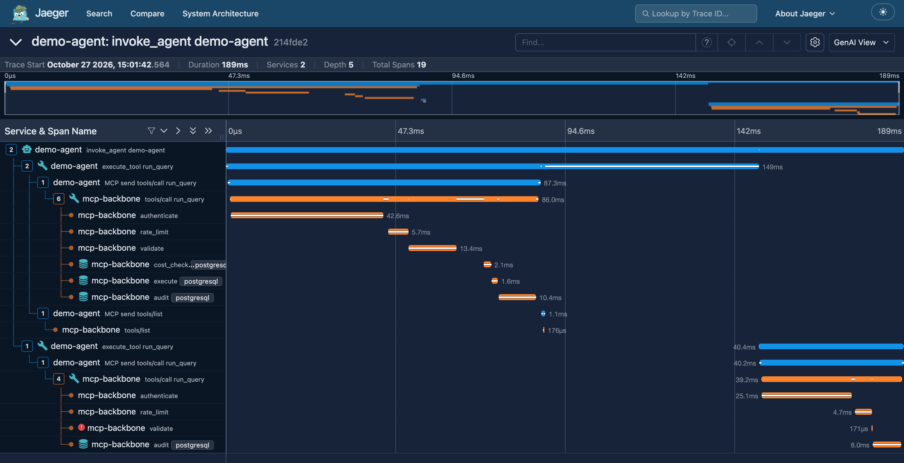
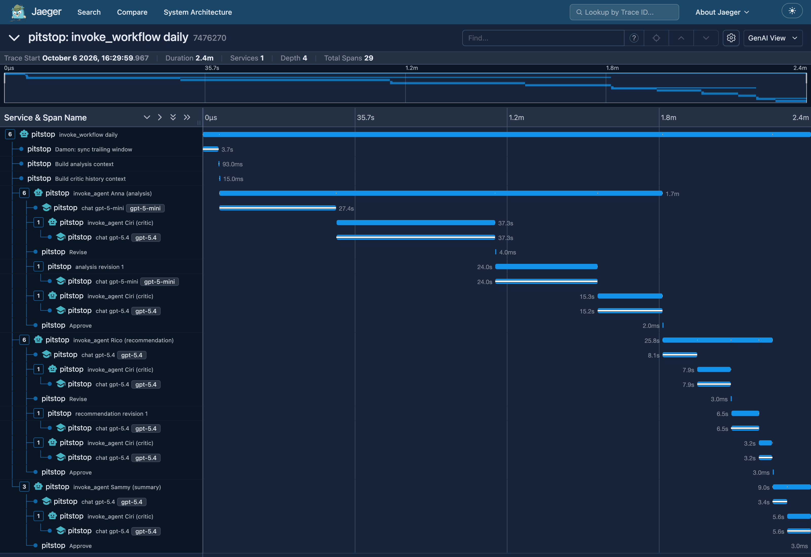
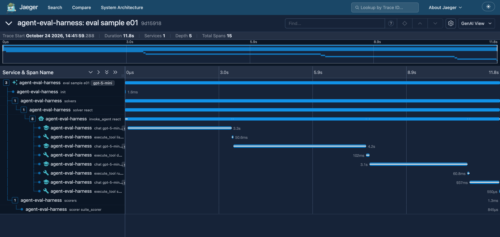
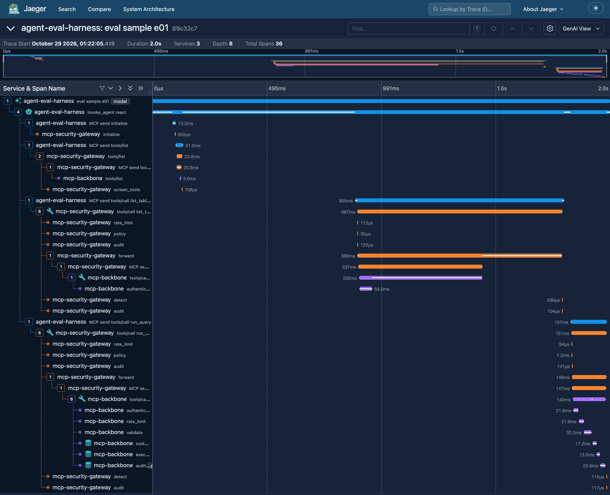

# Results

What the traces look like, and what's checked. How to reproduce the
traces is in [`running.md`](running.md).

## What it looks like

An agent process calling MCP-backbone: one trace across two processes.
The agent's trace context travels in each MCP request's `_meta`; the
refused `DELETE` is marked on the stage that refused it (`validate`), and
no SQL text is recorded.

A Pitstop daily run, replayed from its records: the workflow, its agents,
the critic's reviews and revisions, and every model call with its tokens
and cost.

One of the harness's evaluation samples, replayed from its Inspect log:
an agent answering a question about the Pagila database through
MCP-backbone's tools. Of its 11.8 s, the four model calls take 11.5 s; the
tool calls take 50–100 ms each.

The whole path, live: the harness's evaluation sample `e01` ("How many
films are in the database?"), answered by its scripted agent through the
gateway and MCP-backbone against the Pagila database, and graded a pass.
One trace, three services, 36 spans: the harness's sample and agent, the
gateway's stages (rate limit, policy, audit, forward, detect), and
MCP-backbone's own stages down to the database. `e2e.check` passes it,
with every process stopped normally. It also shows where the time goes:
listing Pagila's tables took 532 ms in MCP-backbone, and the gateway's
`forward` ran on for about 350 ms after the upstream had answered.

## What's checked

- **MCP-backbone's own spans carry no query content by default.** It
  records no SQL text, rejection reasons or error messages unless
  `APP_OTEL_CAPTURE_CONTENT` is on; a test plants a marker in every path a
  query's text can take (run, refused, errored, a failed audit write) and
  finds it in no span. This covers MCP-backbone only: it says nothing
  about the attributes the replays write.
- **Tracing can't hurt the traced system.** With the viewer down, tool
  calls still succeed, and a shutdown gives up flushing after 2 s,
  however many spans are queued (the SDK alone took 5.3 s with a full
  queue). Without an endpoint configured, nothing is exported at all.
- **The replays are faithful.** Every recorded step appears once, with
  the same parent, start time (to the microsecond) and duration. For
  Pitstop, the model-call costs in each run add up to its recorded total
  (26 runs had one); for the harness, each sample's model-call cost and
  tokens add up to its recorded totals. `0 problems` on all 62 Pitstop
  runs (653 steps) and all 1,777 harness samples (7,068 real model calls,
  from 20 published Inspect runs), checked against the viewer's API.
- **Cheap, measured at the median and the tail.** Tracing adds
  **+0.39 ms** (**1.4%**) to the median MCP-backbone tool call, with no
  detectable difference at p95 or p99; the one tail effect found (calls
  that overlap an export are slower, too rarely to move p99) is explained,
  with every number and confidence interval, in
  [`mcp-backbone-overhead.md`](mcp-backbone-overhead.md).
- **Small.** Jaeger runs in 256 MB, keeping at most 5,000 traces in
  memory: 79 MiB with both replays loaded (29,500 spans). A restart
  empties the viewer, and the replays refill it in seconds. Why not on
  disk: [the storage decision](planning/phase-5-architecture-decisions.md#adr-001-the-viewer-is-jaeger-v2-in-one-container-with-badger-storage).
- **The tests catch what they should.** Every new test was
  mutation-checked: 12 mutations in MCP-backbone and 20 in the replays,
  all caught. One exposed a real bug (the exporter ignored the endpoint it
  was given), now fixed.
